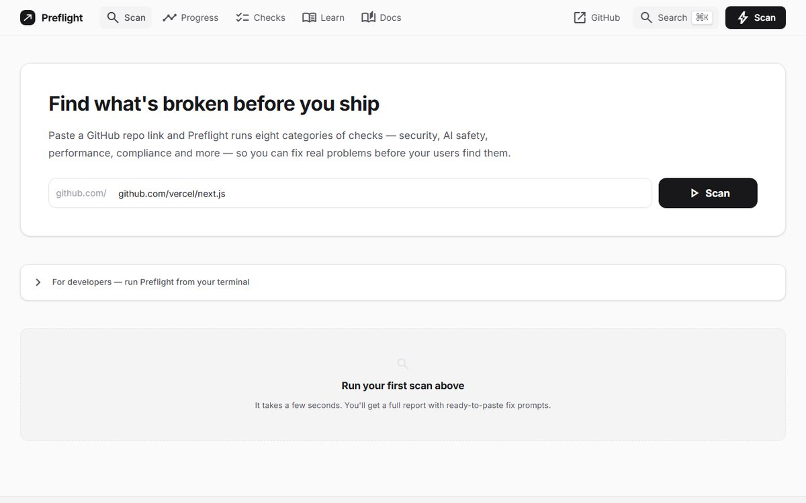

<picture>
  <source media="(prefers-color-scheme: dark)" srcset="assets/header-dark.svg">
  
</picture>

I've built a study platform of my own, contributed to a payments gateway, and made websites for businesses around Nairobi. Most of my time right now goes into Edyfra.

[marsleymash.space](https://www.marsleymash.space) &nbsp;/&nbsp; [LinkedIn](https://ke.linkedin.com/in/marsley-anunda-840ab82b0) &nbsp;/&nbsp; [X](https://x.com/marsleymash)

## Things I've built

<table>
<tr>
<td width="50%" valign="top">

**Edyfra** &nbsp;·&nbsp; founder, 2024 to now

A study platform for Kenyan students from Form 1 to university: Mash AI, verified tutors, a student community and past papers in one place. Won Best Project at a 2025 hackathon.

[edyfra.online](https://www.edyfra.online)
</td>
<td width="50%" valign="top">

**Cyzora** &nbsp;·&nbsp; contributor

A payment gateway for Kenyan businesses. One integration covers M-Pesa and every other way to pay.

[cyzora.co.ke](https://cyzora.co.ke)
</td>
</tr>
<tr>
<td width="50%" valign="top">

**Agent Preflight** &nbsp;·&nbsp; open source

Scans a repo for the mistakes AI coding agents keep making: exposed API keys, missing Supabase RLS, unprotected routes and payment webhooks that never check signatures.

[Try it](https://agent-preflight-eight.vercel.app/) &nbsp;/&nbsp; [Code](https://github.com/marsley01/agent-preflight)
</td>
<td width="50%" valign="top">

**Something broken on your website?**

DNS, SSL, a mobile layout that fell apart, a contact form or checkout that stopped working, WordPress and WooCommerce. I find out why and fix it.

Fixes from KSh 1,500. I reply within a day.

[Send me the problem](https://www.marsleymash.space/contact)
</td>
</tr>
</table>

## What I work with

Next.js, React, TypeScript, Node.js and Python. Supabase and PostgreSQL for data, Tailwind for styling, M-Pesa for payments, and Vercel and Cloudflare for hosting.
